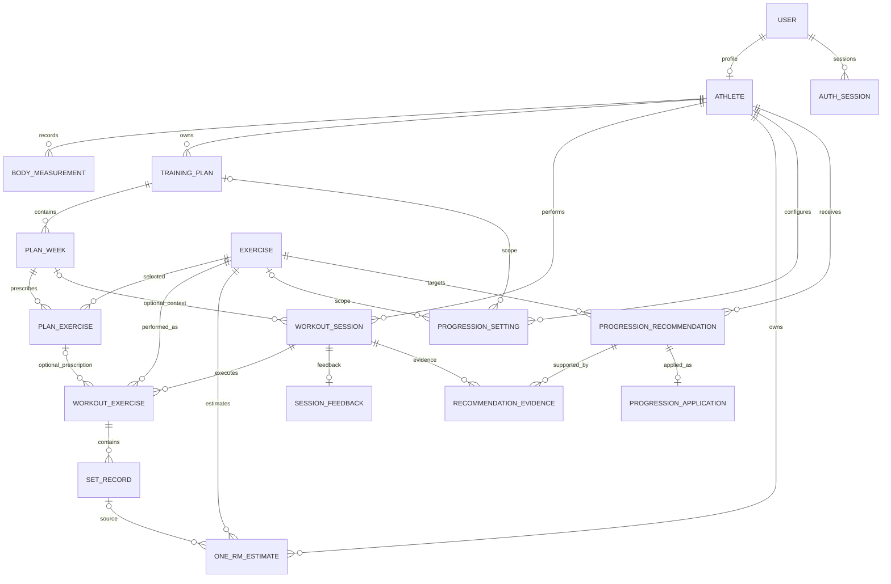

# Modelo de datos y contrato de recursos

**Estado:** referencia del esquema de persistencia Prisma actual. Los nombres HTTP y los flujos de escritura descritos en `docs/api/openapi.yaml` son una propuesta de contrato: no se encontró una especificación API anterior ni endpoints de dominio implementados en el repositorio. No deben tratarse como acuerdos aprobados hasta resolver las decisiones señaladas en `docs/api/conventions.md`.

## Límites del modelo

El esquema es PostgreSQL y está definido en `backend/prisma/schema.prisma`. La API usa identificadores UUID y DTO JSON en `camelCase`; el DTO es una vista explícita del modelo, no una exposición directa de filas Prisma. Nunca se devuelve `passwordHash`, `refreshTokenHash` ni identificadores internos de familia de tokens.

## Entidades expuestas y correspondencia

| Recurso/API DTO | Entidad Prisma | Campos relevantes y límites |
| --- | --- | --- |
| `User` (solo `/auth/me` y auth) | `User` | `id`, `email`, `status`, `createdAt`, `updatedAt`. Nunca incluye hash de contraseña. El perfil de deportista es opcional en el modelo. |
| `Athlete` | `Athlete` | `id`, `userId`, `birthDate`, `preferredUnit` (`KG`/`LB`), fechas. El `userId` es único. La API propuesta identifica al usuario mediante `/athletes/me`, no acepta cambiar `userId`. |
| `BodyMeasurement` | `BodyMeasurement` | `id`, `bodyWeight`, `measuredAt`, `notes`. El peso usa `Decimal(7,3)`. El atleta se deriva de la identidad autenticada. |
| `Exercise` | `Exercise` | `id`, `name`, `muscleGroup`, `equipment`, `description`, `isActive`, fechas. No se definió quién administra el catálogo ni si es editable por clientes. |
| `TrainingPlan` | `TrainingPlan` | `id`, `name`, `startsOn`, `endsOn`, `status`, fechas. `athleteId` se resuelve por autorización. |
| `PlanWeek` | `PlanWeek` | `id`, `weekNumber`, `objective`; `weekNumber` es único dentro del plan. |
| `PlanExercise` (prescripción) | `PlanExercise` | `id`, `exerciseId`, `position`, `targetSets`, `targetReps`, `targetRpe`, `targetLoad`, `notes`. No es un resultado ejecutado. |
| `WorkoutSession` | `WorkoutSession` | `id`, `status`, `startedAt`, `finishedAt`, `notes`, fechas. `trainingPlanId`/`planWeekId` son opcionales; una sesión puede ser libre. |
| `WorkoutExercise` (ejecución) | `WorkoutExercise` | `id`, `exerciseId`, `planExerciseId?`, `orderInSession`, `notes`. `planExerciseId` solo enlaza con la prescripción; la sesión conserva su propia lista ejecutada. |
| `SetRecord` | `SetRecord` | `id`, `setNumber`, `load`, `repetitions`, `rpe?`, `isCompleted`, `recordedAt`, `notes`. RPE de serie no se mezcla con RPE global. |
| `OneRmEstimate` | `OneRmEstimate` | Entrada `inputLoad`/`inputReps`, `estimatedOneRm`, `formula` (`EPLEY`/`BRZYCKI`), `algorithmVersion`, `calculatedAt`, `sourceSetId?`. Es histórico; no se sobrescribe. |
| `SessionFeedback` | `SessionFeedback` | Uno por sesión: `globalRpe?`, `fatigueScore?`, `notes`, `recordedAt`. El modelo no define fórmula ni escala de fatiga. |
| `ProgressionSetting` | `ProgressionSetting` | `minSuccessfulSessions`, rango RPE, incrementos, `maxLoad?`, `autoApplyAuthorized`. Los alcances son general, ejercicio, ejercicio/plan; plan sin ejercicio es inválido. |
| `ProgressionRecommendation` | `ProgressionRecommendation` | Contexto deportista/ejercicio, `planWeekId?`, `planExerciseId?`, cargas, justificación, estado, versión, snapshot de configuración, fechas. |
| `RecommendationEvidence` | `RecommendationEvidence` | Sesión, rol (`SATISFACTORY`, `UNSATISFACTORY`, `CONTEXT`) y fecha; una sesión no se asocia dos veces a la misma recomendación. |
| `ProgressionApplication` | `ProgressionApplication` | Una por recomendación; `appliedLoad`, origen (`MANUAL`/`AUTOMATIC`) y `effectiveAt`. |

## Estados controlados

- Cuenta: `ACTIVE`, `SUSPENDED`, `CLOSED`.
- Plan: `DRAFT`, `ACTIVE`, `COMPLETED`, `ARCHIVED`.
- Sesión: `PLANNED`, `IN_PROGRESS`, `COMPLETED`, `CANCELLED`.
- Recomendación: `PENDING`, `APPROVED`, `REJECTED`, `APPLIED`, `BLOCKED`, `EXPIRED`.
- Aplicación: `MANUAL`, `AUTOMATIC`.

El esquema de persistencia no determina transiciones permitidas entre estados; la API no debe permitir asignar cualquier estado mediante un `PATCH` genérico. Las transiciones aún requieren decisión de producto.

## Integridad y validación transaccional

Las migraciones SQL comprueban rangos de RPE, cargas, repeticiones, fechas, semana/posición/orden positivos, alcance válido de progresión e índices únicos parciales para sus tres alcances. Las restricciones únicas también aseguran correo, perfil por usuario, semana/posición/orden, serie por ejercicio ejecutado, feedback por sesión, evidencia por recomendación/sesión y aplicación por recomendación.

Claves foráneas compuestas mantienen la pertenencia de la sesión a plan y semana, la concordancia entre ejercicio prescrito y ejecutado y la pertenencia de una configuración al atleta y plan. Los siguientes cruces requieren validación en una transacción de servicio: relación entre atleta/ejercicio y serie de origen de una estimación; compatibilidad completa de atleta, plan, semana y prescripción en una recomendación; pertenencia de cada sesión de evidencia al atleta y contexto recomendado; y verificación de estado, vigencia, consentimiento y límites justo antes de aplicar una recomendación automáticamente.

## Decisiones API pendientes

No se encontró un contrato REST anterior. Rutas, métodos, DTO de escritura, paginación y operaciones de ciclo de vida de planes/sesiones/recomendaciones en el OpenAPI adjunto son una propuesta explícita, no evidencia de funcionalidad existente. También quedan por decidir: registro público; política de unidades en cargas; escala de fatiga; permisos de catálogo; transiciones de estado; política de acceso/rotación/revocación de sesiones; algoritmo y gatillo de aplicación automática; si el cliente puede pedir generación de recomendaciones; y estrategia exacta de paginación y decimales JSON.
